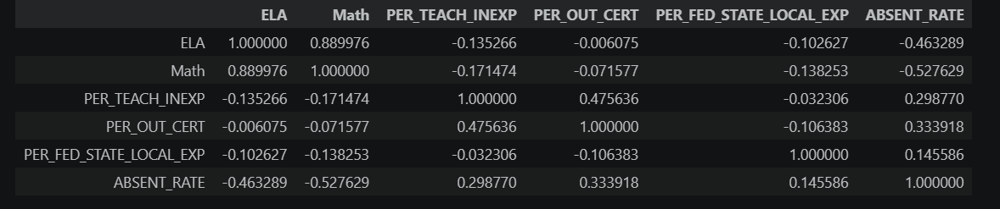
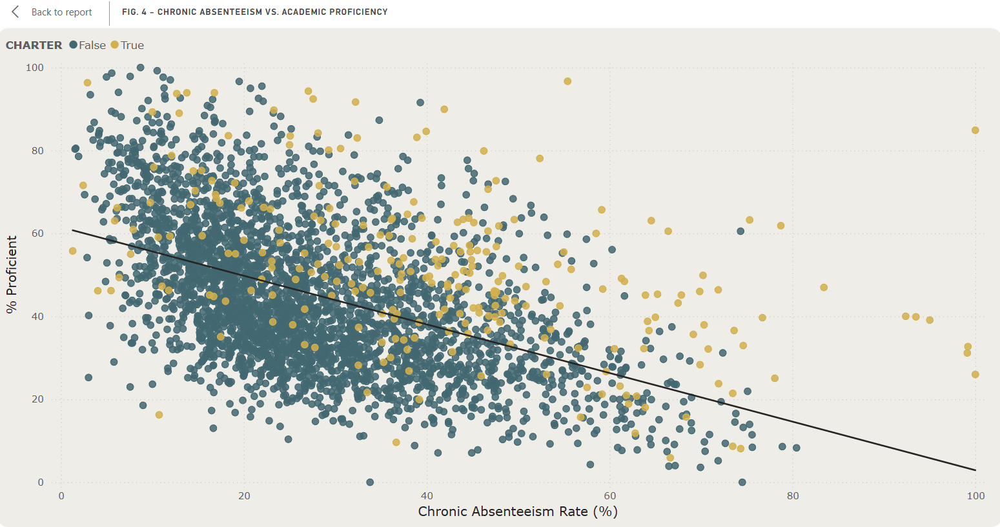
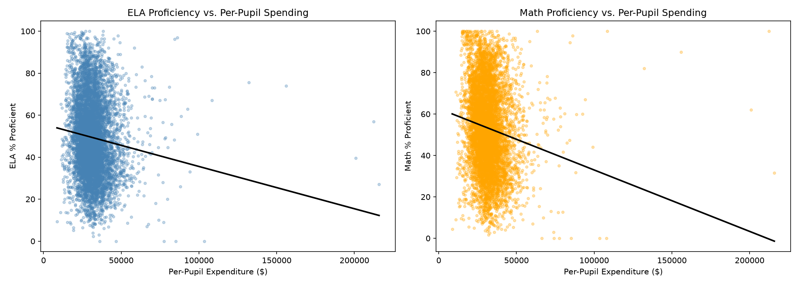
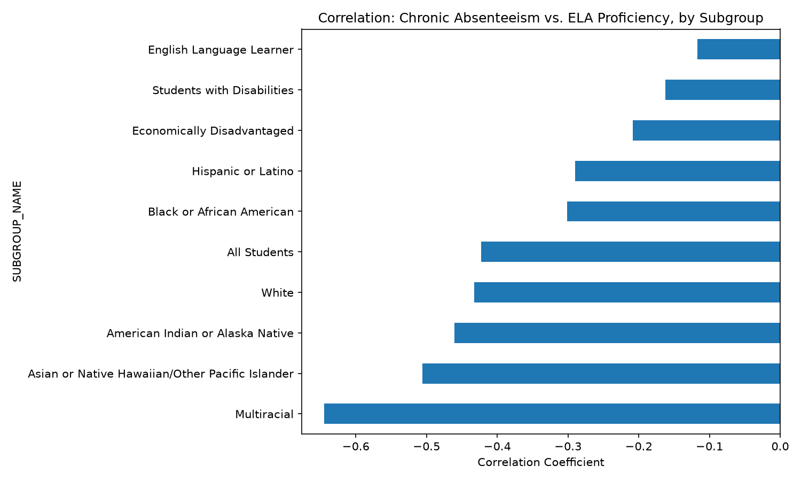
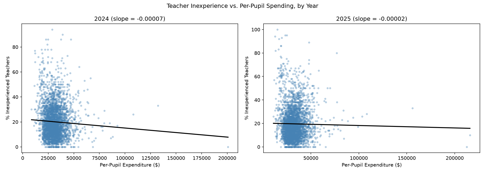
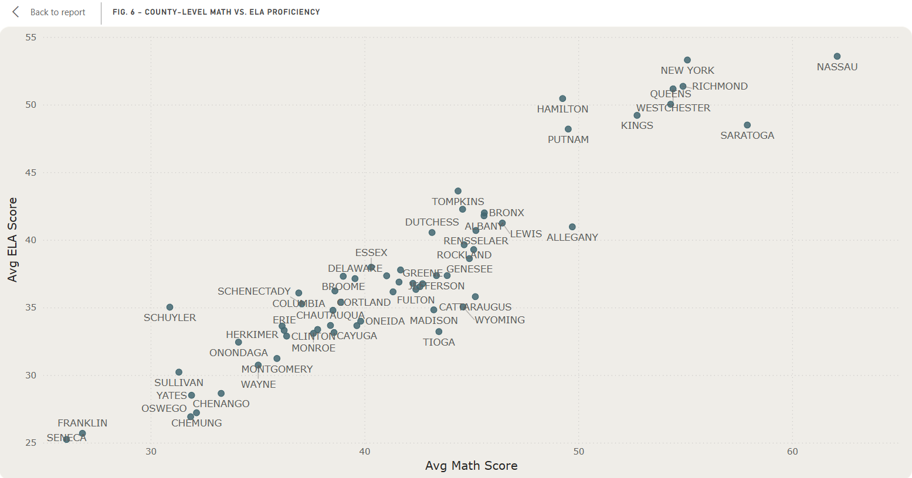

# Charter vs. District: Examining Performance Gaps in New York State Schools

## Project Links

The full [Python analysis notebooks](notebooks/) walk through the cleaning, exploration, and statistical modeling behind this project.

The interactive Power BI dashboard is in progress and will be linked here once it's published.

## Motivation

I work as a Data Analyst for Charter Public Schools, where I build reporting and analytics on school performance data every day. That work is built on private, internal data, so I can't share any of it publicly. This project is my way of doing similar work in the open: using New York State's public Report Card data to ask the same kinds of questions I ask at work, on a dataset anyone can download and check.

Charter schools get compared to district schools constantly, often with strong opinions attached and not much digging into *why* the numbers look the way they do. I wanted to take a real analytical pass at that comparison: where the gap is genuinely there, where it disappears once you control for other factors, and where the obvious story turns out to be wrong.

## Questions

**How do school type, funding, staffing, and attendance relate to academic performance across New York State?**

- Do charter schools perform differently than district schools, and does that gap hold up once other factors are accounted for?
- Is chronic absenteeism the strongest predictor of proficiency, or does it compete with funding and teacher experience?
- Does more per-pupil funding translate to better outcomes, or is the relationship more complicated than that?
- How do these patterns shift across student subgroups (race/ethnicity, English language learners, students with disabilities, economically disadvantaged)?

## Skills Used

- Connecting to and querying an Access database with `pyodbc`
- Data cleaning and filtering across 30+ raw tables, narrowed down to 5 clean, analysis-ready tables
- Merging and reshaping data with `pandas` to build a school-level analysis dataset
- Correlation analysis and multi-variable linear regression with `scikit-learn`
- Subgroup-level statistical breakdowns to check whether overall patterns hold across different student populations
- Power BI data modeling: building a star schema (fact and dimension tables) and writing DAX measures, rather than handing Power BI a single pre-merged table
- Git/GitHub for version control

## Data Sources and Tools Used

Data comes from the [New York State Report Card Database](https://data.nysed.gov/downloads.php) (SRC2025_Group4), published by the New York State Education Department. It covers the 2023-24 and 2024-25 school years and includes school-level accountability, assessment, staffing, funding, and attendance data for every public school in the state, charter and district alike.

`Python / Jupyter Notebook` - for connecting to the raw Access database, cleaning the data, and running the statistical analysis

`pandas` / `scikit-learn` - for data wrangling, correlation analysis, and regression modeling

`Power BI` - for building the interactive dashboard and data model

`Git` - for version control

## Major Findings

**Chronic absenteeism is the single strongest predictor of academic proficiency**, more so than funding or teacher experience. This held true across a full correlation matrix and a multi-variable regression controlling for all factors at once.

**The raw charter vs. non-charter gap is more complicated than it looks.** On their own, charter schools show less per-pupil funding, more inexperienced teachers, and higher chronic absenteeism than district schools. But once those factors are statistically controlled for, charter status is actually associated with *higher* proficiency, not lower. The uncontrolled comparison was masking the real story.

**Per-pupil funding has close to zero independent effect on proficiency once need is accounted for.** Schools serving higher-need student populations tend to receive more funding *and* post lower scores, which creates a misleading negative correlation if you look at funding alone. The regression coefficient for funding was effectively zero once attendance, staffing, and charter status were controlled for.

**The strength of the absenteeism-performance link varies a lot by subgroup.** It's strongest for Multiracial, Asian/Pacific Islander, and White students, and noticeably weaker for English Language Learners, Students with Disabilities, and Economically Disadvantaged students. That's the opposite of what I expected going in. My working theory is that for students facing multiple compounding barriers, absenteeism is just one factor among several, which dilutes its individual statistical pull even though overall outcomes for these groups are still lower.

**Funding doesn't meaningfully predict teacher experience at the individual school level**, even though it does at the group level. Charter schools as a group have both less funding and less experienced staff, but when you look school-by-school, the funding-to-experience relationship is essentially flat in both years (slope of about -0.00007 in 2024 and -0.00002 in 2025). The group-level pattern doesn't hold up as a general, school-by-school rule.

**Performance by county shows a clear geographic pattern.** Counties strong in ELA tend to be equally strong in Math, with no real subject-specific outliers. Downstate and NYC-metro counties cluster at the top for both subjects, while rural upstate counties cluster at the bottom.

## Conclusions

The headline finding here is that attendance matters more than money. Chronic absenteeism outweighs both funding and teacher experience as a predictor of proficiency, which suggests that interventions aimed at getting kids in the building consistently may do more for outcomes than funding increases alone, though both clearly matter in different ways.

The charter school story is a good reminder to be careful with raw comparisons. Charter schools look worse off on paper across funding, staffing, and attendance, but once you control for those factors, they slightly outperform district schools on the same metrics. Neither the simple "charters underperform" nor "charters overperform" narrative holds up on its own. The real story is in the controlled comparison.

The funding-and-need relationship is a classic confounding pattern: money follows need, and need predicts lower scores independent of the money itself. That doesn't mean funding doesn't matter. It means a simple funding-vs-performance scatter plot will always look worse than the underlying reality, because the schools getting more funding are, by design, the ones facing more challenges to begin with.

## Limitations

A handful of schools, mostly small charter schools, show exactly 100% chronic absenteeism despite being flagged as having reported complete data. I wasn't able to confirm whether this reflects a genuine reporting pattern or a data quality issue in the source file, so I've flagged it here rather than quietly excluding or correcting it.

The regression model explains roughly 27-33% of the variation in proficiency scores (R² of 0.271 for ELA, 0.327 for Math), meaning there's a meaningful amount of variation these five factors don't capture. This is a reasonable starting model, not a complete explanation of what drives school performance.
